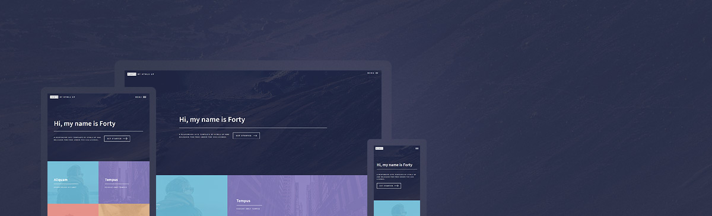

# Instalation
Jekill bundler installation.

```console
> sudo apt install ruby-dev
> sudo apt install build-essential
> sudo apt install ruby-bundler
```

## Setting local vendor folder for install gems
Due to sometimes the cache folder may be constrained by the OS, i.e. Ubuntu, a solution is to install the gems in local environments, but without uploading that folder to the repository.

```console
> bundle config set --local path 'vendor/bundle'
> bundle install
```

## Install gem dependencies
```console
> bundle install
```

# RUN

```console
> bundle exec jekyll serve
```

## For tracking erros

```console
> jekyll build --trace
```

## Compiling output

```console
> bundle exec jekyll build --destination /home/donnetoo/GIT/craquinterogo.github.io
```

# Forty - Jekyll Theme

## Blog category navigation

The All Posts and My Posts pages share the category browser in
[`_layouts/allposts.html`](./_layouts/allposts.html), styled by
[`assets/css/allposts.css`](./assets/css/allposts.css). Categories appear in a
four-column grid on desktop and a two-column grid between 681px and 900px,
with wrapping labels and post counts instead of horizontal scrolling. At 680px
or less, a compact native dropdown lists all categories with their post counts.
The dropdown and grid stay in sync when resizing or rotating a device.
Selecting a category filters the post list and preserves its URL hash for direct
links. Keyboard users can move between grid categories with Left/Right arrows,
Home, and End, or use native dropdown controls on small screens; Tab moves into
the selected post panel. Reduced-motion preferences are respected.

## Post reading layout

[`assets/css/post.css`](./assets/css/post.css) gives posts a responsive article
canvas up to 1200px wide. Prose, headings, code blocks, tables, and figures share
the full canvas width, with larger system-font text and generous line spacing.
Long code and tables scroll within their own
keyboard-focusable containers instead of widening the page.

The contents sidebar remains visible at 1200px and above. Related posts remain
visible at 1600px and above. Below those thresholds, labeled buttons open the
respective drawers; Escape or the backdrop closes them. The post template
preserves inline heading formatting when generating its numbered contents list.

A Jekyll version of the "Forty" theme by [HTML5 UP](https://html5up.net/).



# How to Use

For those unfamiliar with how Jekyll works, check out [jekyllrb.com](https://jekyllrb.com/) for all the details,
or read up on just the basics of [front matter](https://jekyllrb.com/docs/frontmatter/), [writing posts](https://jekyllrb.com/docs/posts/),
and [creating pages](https://jekyllrb.com/docs/pages/).

- **GitLab**: Simply fork this repository and start editing the `_config.yml` file!
- **GitHub**: Fork this repository and create a branch named `gh-pages`, then start editing the `_config.yml` file.

# Added Features

- **[Formspree.io](https://formspree.io/) contact form integration** - just add your email to the `_config.yml` and it works!
- Use `_config.yml` to **set whether the homepage tiles should pull pages or posts**, as well as how many to display.
- Add your **social profiles** easily in `_config.yml`. Only social profiles buttons you enter in `config.yml` show up on the site footer!
- Set **featured images** in front matter.

# Issues

If you would like to report a bug, ask a question, request a feature, feel free to do so on [the GitLab repository](https://gitlab.com/andrewbanchich/forty-jekyll-theme) and I will be more than happy to help!

Alternatively, you can open an issue via email by emailing [incoming+andrewbanchich/forty-jekyll-theme@incoming.gitlab.com](mailto:incoming+andrewbanchich/forty-jekyll-theme@incoming.gitlab.com).

The GitHub repository is simply a mirror of the GitLab repository.

# Credits

Original README from HTML5 UP:

```
Forty by HTML5 UP
html5up.net | @ajlkn
Free for personal and commercial use under the CCA 3.0 license (html5up.net/license)


This is Forty, my latest and greatest addition to HTML5 UP and, per its incredibly
creative name, my 40th (woohoo)! It's built around a grid of "image tiles" that are
set up to smoothly transition to secondary landing pages (for which a separate page
template is provided), and includes a number of neat effects (check out the menu!),
extra features, and all the usual stuff you'd expect. Hope you dig it!

Demo images* courtesy of Unsplash, a radtastic collection of CC0 (public domain) images
you can use for pretty much whatever.

(* = not included)

AJ
aj@lkn.io | @ajlkn


Credits:

	Demo Images:
		Unsplash (unsplash.com)

	Icons:
		Font Awesome (fortawesome.github.com/Font-Awesome)

	Other:
		jQuery (jquery.com)
		html5shiv.js (@afarkas @jdalton @jon_neal @rem)
		background-size polyfill (github.com/louisremi)
		Misc. Sass functions (@HugoGiraudel)
		Respond.js (j.mp/respondjs)
		Skel (skel.io)
```

Repository [Jekyll logo](https://github.com/jekyll/brand) icon licensed under a [Creative Commons Attribution 4.0 International License](http://choosealicense.com/licenses/cc-by-4.0/).
